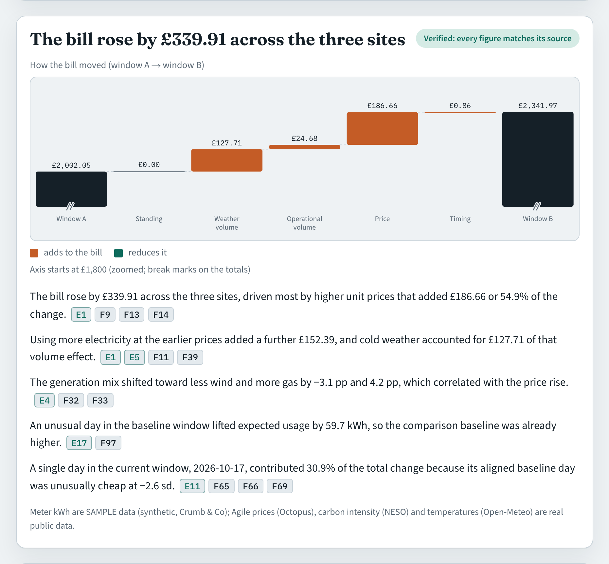
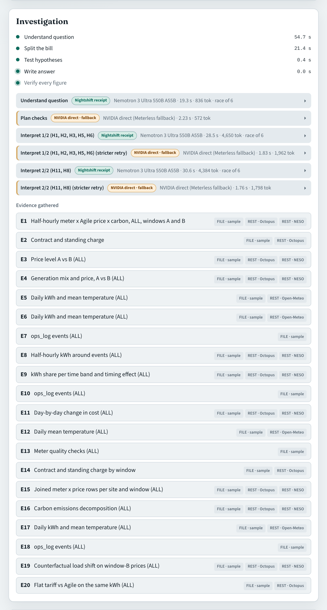
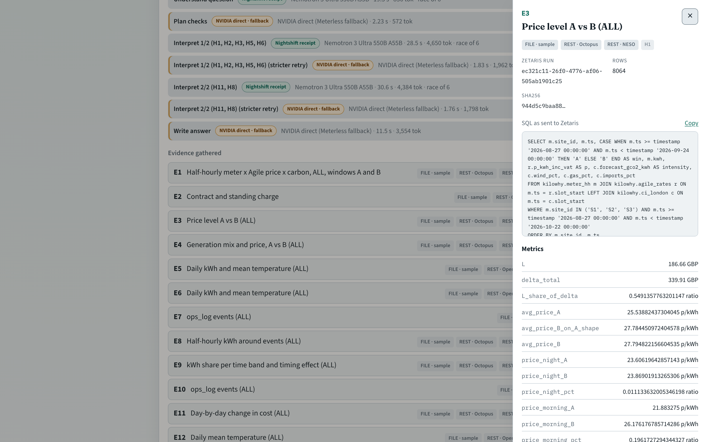
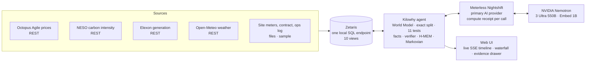

# Kilowhy

**Ask why your electricity bill changed. Every number is backed by a query.**

Kilowhy is an agent for small businesses on half-hourly electricity tariffs. The owner asks a plain question ("Why did our electricity cost more in the last four weeks?"). Kilowhy investigates across federated data, splits the change exactly into its causes, tests eleven hypotheses, and answers in plain English. Every figure in the answer is traced to the Zetaris query that produced it.

Built for the **Open Agent Hackathon 2026**, Track 02 "The Agent That Can Explain Why". It uses Zetaris, Meterless (Nightshift plus the H-MEM, World Model and Markovian engines) and NVIDIA Nemotron, and the UI was built with Cursor.

Demo video: _link added at submission_ · Slides: _link added at submission_



## What it does

- **Who it is for:** owners and ops leads of small multi-site UK businesses on half-hourly tariffs such as Octopus Agile. The demo business is "Crumb & Co", three London bakeries: Shoreditch, Brixton and Hampstead.
- **The problem:** the bill moves every month and the reasons are spread over five places: half-hourly prices, grid carbon, generation mix, weather and the site's own meters.
- **What Kilowhy does:**
  1. **Split the bill exactly.** The change is divided into price, weather-driven volume, operational volume, timing and standing charge, and the parts sum to the change to the penny.
  2. **Test 11 causes.** Each hypothesis is a federated SQL test with a stated rule, and the result is *supported*, *ruled out* or *inconclusive*.
  3. **Write and verify.** Nemotron writes the explanation using fact placeholders. Kilowhy fills in every figure from the evidence, and a verifier checks every figure, citation and cause before the answer is shown.
  4. **Recommend.** Options are counterfactuals on real prices: another tariff, or moving flexible load. They are ranked by their computed £ effect.
- **Memory:** the owner can add a note ("Brixton moved its oven schedule from 7 Oct"). Meterless H-MEM keeps it with its provenance and an audit trail, and recalls it in later answers.

### A real answer (live, all sites)

> **The bill rose by £339.91 between the two four-week windows.** Higher wholesale prices added £186.66 and colder weather added £127.71; operations added £24.68 and timing £0.86, with no change in the standing charge. Meter faults, a tariff change, data gaps and a timing shift are ruled out; a one-off freezer-fault day at Hampstead is found. Staying on Agile cost £504.69 less than Flexible Octopus Business for the same electricity.

Windows: 27 Aug–23 Sep vs 24 Sep–21 Oct 2026. Meter readings are **sample data**. Agile prices (Octopus), carbon intensity and generation mix (NESO), generation by fuel (Elexon) and temperature (Open-Meteo) are real public data.

| | |
|---|---|
|  |  |
| Live timeline: steps, evidence, the model and route per LLM call | Evidence drawer: the SQL sent to Zetaris, sources, run id, rows, SHA-256 |

## How it works



1. **Understand.** Nemotron classifies the question, and the World Model resolves the site it names ("Brixton" → S2). An unknown name becomes a clarifying question, never a guess.
2. **Split.** One federated query per window joins half-hourly meter readings to half-hourly prices. The decomposition is exact arithmetic: volume `(Q_B−Q_A)·P̄_A`, price `Q_B·(P̄_B*−P̄_A)`, timing `Q_B·(P̄_B−P̄_B*)`, and standing.
3. **Test.** Eleven hypothesis tests run, each a guarded read-only SQL query:
   - price level, generation mix, weather (pooled OLS on heating degree days), operational change, timing shift, one-off day, meter fault, tariff change, data gap, carbon, unusual-use day;
   - every test produces evidence records holding the SQL, Zetaris run id, row count and SHA-256 of the result.
4. **Reason in bounded steps.** The Markovian engine runs plan → interpret → write → verify as chunks with a compact carryover.
5. **Write and verify.** Nemotron writes sentences with `{F#}` placeholders. Kilowhy fills them from the facts table, and the verifier enforces three rules:
   - every number matches a cited fact;
   - every sentence cites evidence;
   - causes match test outcomes, and recommendations lead with the largest computed effect.
6. **Remember.** Supported causes and owner notes go into H-MEM with provenance, and the next investigation recalls them.

## Sponsor technology

### Zetaris — the data harness
- **Local platform:** Zetaris 2.4.3 runs in Docker on the developer's Mac. It federates four live REST APIs and the site files behind one SQL endpoint, and Kilowhy never copies data into a database of its own.
- **REST tables:** one table per date window, cached, then unioned into 10 views. Nested JSON is flattened in SQL (`LATERAL VIEW explode`, `arrays_zip`). The DDL is generated by `scripts/zetaris_ddl.ts`, and `--warm` re-caches after a restart.
- **Every figure is a query:** each hypothesis test is one federated SELECT through a read-only guard (`server/src/sqlguard.ts`). The UI shows the exact SQL, Zetaris run id and rows for every evidence record.
- **Reconciliation:** per-site costs from one federated query equal an independent calculation from the raw Octopus API in all six site-windows, to the penny (`eval/reconciliation.json`).

### Meterless — Nightshift as the AI provider, three engines doing real work
- **Nightshift** is the app's primary AI provider. Kilowhy implements runtime contract v4 in `server/src/provider.ts`:
  - base URL `127.0.0.1:8088/v1`, token from the runtime's `proxy-token`, `meterless-app: kilowhy`;
  - online / unauthorized / offline states and auto-detect.
  
  Every LLM step shows its compute receipt in the UI: routed model, race width, latency and tokens. An NVIDIA-direct route exists only as a clearly labelled fallback.
- **Engines.** All three Meterless engines are mounted as working parts of every investigation. They are pre-existing open-source components (Apache-2.0), vendored unchanged under `vendor/meterless/` (the upstream commit and licence are in `vendor/README.md`) and imported as libraries; the integration code is Kilowhy's own.

| Engine | What it does in Kilowhy | Code | See it work |
|---|---|---|---|
| **H-MEM** | Investigation memory. Notes the owner tells us and causes the agent confirmed are stored with provenance (source, evidence ids, Zetaris run ids, Nightshift receipt ids). Every investigation recalls what is relevant at the start (hybrid ranking with a retrieval trace), each recalled memory becomes an `M#` fact the answer may cite, and every write, read and feedback lands in the append-only trust ledger. | `server/src/memory.ts` (`remember`, `recall`, `audit`, `feedback`), `memory_confirm.ts` (`confirmCauses`), `agent.ts` + `agent_memory.ts` | `node scripts/note.ts --site S2 "..."`, `node scripts/note.ts --audit mem-6`, `eval/memory_demo.json`, UI memory panel |
| **World Model** | Grounded entities read from Zetaris: sites (with aliases such as "Brixton"), meters, the contract, the Agile tariff and the flat comparison tariff, and the `ops_log` events as bitemporal edges and facts, each stamped `{view, zetarisRunId, at}`. The site a question names is resolved with the engine's 0.85 / 0.82 resolve bands, and the events in a window feed the H4, H5 and H11 evidence. Re-ingest is idempotent. | `server/src/worldmodel.ts` (`ingest`, `resolveSite`, `factsFor`), `worldmodel_ingest.ts`, `worldmodel_resolve.ts` | `node scripts/worldmodel_check.ts` (ingests twice: empty diff, 12 entities, 10 relationships, 3 facts) |
| **Markovian** | The LLM part of an investigation runs as bounded chunks on the engine's orchestrator: plan, interpret the hypothesis results in batches, narrative, verify. Only a compact JSON carryover (at most 800 tokens) travels between chunks, and a rejected draft is corrected in a new chunk that carries the verifier's errors. Tokens per chunk are logged next to the reference's naive full-history estimate. | `server/src/investigate_markovian.ts`, `markovian_state.ts`, `markovian_log.ts` (default engine) | `node scripts/ask.ts "..."` prints the chain; `eval/markovian_tokens.json`; UI chart |

`node scripts/engines_check.ts` runs each engine's own test suite (10 + 10 + 10 tests pass).

**Memory demo (live, sample meter data).** The owner adds a note with `node scripts/note.ts --site S2 "Brixton moved its oven schedule 2 hours later from 7 Oct for the new sourdough line"`. The next Brixton answer recalls it as `M1` and places it beside the timing test:

> A timing shift moved the oven schedule two hours later on 7 Oct "Brixton moved its oven schedule ..." (your note, 2026-10-22), but the timing effect on the bill was only 1.0%.

`node scripts/note.ts --audit mem-6` shows the create, the update and every recall, with actors and timestamps.

**Markovian token log.** Over the logged Brixton runs the chain sent about 3,700 to 4,000 estimated input tokens, against about 6,700 to 7,200 for the naive full-history version: 44% less. The carryover held at 160 to 300 estimated tokens per chunk. Estimates use the reference engine's characters/4 estimator; measured provider usage is listed beside it where available.

### NVIDIA Nemotron — the reasoning
| Step | Model (through Nightshift) | What it decides |
|---|---|---|
| Understand | Nemotron 3 Ultra 550B | question type, sites, dates |
| Plan | Nemotron 3 Ultra 550B | which causes to emphasise |
| Interpret | Nemotron 3 Ultra 550B | what each batch of test results means |
| Write | Nemotron 3 Ultra 550B | the plain-English answer, with fact placeholders |
| Remember | Nemotron Embed 1B | which notes are relevant (H-MEM recall) |

Nightshift races up to six routes per call and reports the winner in its receipt. Thinking is switched off for the writing step (`chat_template_kwargs.enable_thinking=false`).

### Cursor — how it was built
Cursor's headless agent (`agent -p … --output-format stream-json`) built the sample-data generator, the whole web UI and its first polish pass. Every prompt is in `docs/cursor-prompts/` and every transcript in `docs/cursor-log/`. Claude Code built the server, the data layer, the hypotheses, the verifier, the engine integration and the evaluation, and it finished the UI polish. [`docs/how-it-was-built.md`](docs/how-it-was-built.md) lists who built what.

## Evaluation

The question: how well does the deterministic layer (exact decomposition, hypotheses H1 to H11, recommendation) recover causes that are planted in meter data, on real market data? Everything runs through the injectable data layer, without Zetaris and without an LLM.

- **Real windows.** Half-hourly Agile price, NESO carbon intensity, wind, gas and import share, and Open-Meteo hourly temperature for the two 28-day windows were read once from Zetaris into `eval/data/real_windows.json`, with the SQL and the Zetaris run ids.
- **Planted causes.** A clean baseline bakery site gets known causes in 12 scenarios (`eval/scenarios.ts`): heating sensitivity, sustained operational steps up and down, an oven schedule moved into the 16:00–19:00 peak, one-off fault days in each window, a zero run and a flatline, missing half-hours, a standing-charge change, and two combinations. Expected verdicts were written down from the plants before the first run. Thresholds are the unchanged constants in `server/src/hypotheses/thresholds.ts`.
- **Run.** `node scripts/eval_run.ts` writes `eval/results/eval_report.md`, which lists expected against got for every hypothesis and scenario, with each statistic beside its threshold.

| Measure | Result |
|---|---|
| Scenarios, scored (scenario, hypothesis) pairs | 12, 91 |
| Pairs answered exactly as expected | 83 of 91 |
| "Supported" precision, recall, F1 | 100% (30 of 30), 93.8% (30 of 32), 96.8% |
| Same, planted causes only | precision 100%, recall 94.1% (16 of 17) |
| Wrong "supported" answers | 0 |
| Decomposition identity V+L+T+S = bill change, within 0.01 GBP | 12 of 12 scenarios |
| Planted cause named correctly (event, day, change point, standing effect) | 16 of 17 |
| Load-shift recommendation finds peak-band load where it is planted | 12 of 12 |

The full tables and method are in [`eval/results/eval_report.md`](eval/results/eval_report.md). The repository has 671 automated tests (`npm test`).

## Run it locally (macOS, Apple Silicon)

**Requirements**
- Node 24 and Docker Desktop (8 GB or more for Docker, with Rosetta on).
- The Zetaris platform bundle from Zetaris Cloud ("Run locally"), unpacked at `~/zetaris/zetaris-platform`, with its registry sign-in done once.
- Meterless Nightshift (Mac edition) running, with an NVIDIA provider configured in its Providers tab.
- A Zetaris API token (created in the local UI under Management → API Tokens). Kilowhy reads it from the macOS keychain (`security add-generic-password -a kilowhy -s ZETARIS_API_KEY -w`) or from `ZETARIS_API_KEY`.
- Optional: an NVIDIA API key (keychain service `NVIDIA_API_KEY` or env) for embeddings and the labelled fallback route.

**First time**

```bash
node scripts/generate_sample.ts        # SAMPLE meter files (deterministic)
./scripts/load_sample_files.sh         # copy them into the Zetaris driver container
node scripts/zetaris_ddl.ts            # register REST + file sources, cache them, create the kilowhy.* views
node scripts/reconcile.ts              # federated cost == independent calculation, to the penny
```

**Every time (also after a reboot)**

```bash
./scripts/start_stack.sh               # Docker → Zetaris (verify + re-cache) → Nightshift check → server on http://127.0.0.1:5174
```

**Ask from the terminal or the UI**

```bash
node scripts/ask.ts "Why did our electricity cost more in the last four weeks?"
node scripts/ask.ts "Why did Brixton use more electricity?" --site S2
```

Open http://127.0.0.1:5174 for the UI. Saved answers are in `eval/answers/`.

## Repository layout

```
server/src/        agent (agent*.ts), provider.ts (Meterless contract v4), decompose.ts, hypotheses/ (H1–H11),
                   facts*.ts, verifier.ts, quality.ts, memory*.ts (H-MEM), worldmodel*.ts, investigate_markovian.ts,
                   data.ts + sqlguard.ts (Zetaris), recommend.ts, http.ts (API + UI)
web/               React + Vite UI (built with Cursor CLI)
scripts/           zetaris_ddl.ts, generate_sample.ts, reconcile.ts, ask.ts, note.ts, engines_check.ts,
                   worldmodel_check.ts, eval_snapshot.ts, eval_run.ts, capture_screens.mjs, start_stack.sh
vendor/meterless/  H-MEM, World Model, Markovian reference engines (Apache-2.0, unchanged)
eval/              reconciliation, decomposition and hypothesis runs, answers, evaluation harness and report
docs/              design notes, latency, how it was built, Cursor prompts and transcripts, screenshots, film script
data/sample/       SAMPLE meter readings, sites, contract, ops log
```

## Pre-existing components

- **Meterless engines.** `vendor/meterless/{hmem,world-model,markovian}` holds the H-MEM, World Model and Markovian reference implementations (Apache-2.0), vendored unchanged; see `vendor/README.md`.
- **Development tools and runtimes:** Zetaris platform 2.4.3 (local Docker bundle), Meterless Nightshift 1.2.1, and the React, Vite and TypeScript toolchain.
- **Kilowhy's own code:** everything else in this repository was written during the build window, starting 22 October 2026.

## Data sources

- Octopus Energy public API: Agile (AGILE-24-10-01, region C) unit rates and standing charge, plus Flexible Octopus Business rates for the counterfactual.
- NESO Carbon Intensity API: London region intensity and generation mix (CC BY 4.0).
- Elexon Insights: half-hourly generation by fuel type (BMRS licence).
- Open-Meteo: hourly temperature for London (CC BY 4.0).
- `data/sample/`: generated meter readings, sites, contract and ops log for the demo business. **Sample data**, labelled as such everywhere it appears.
